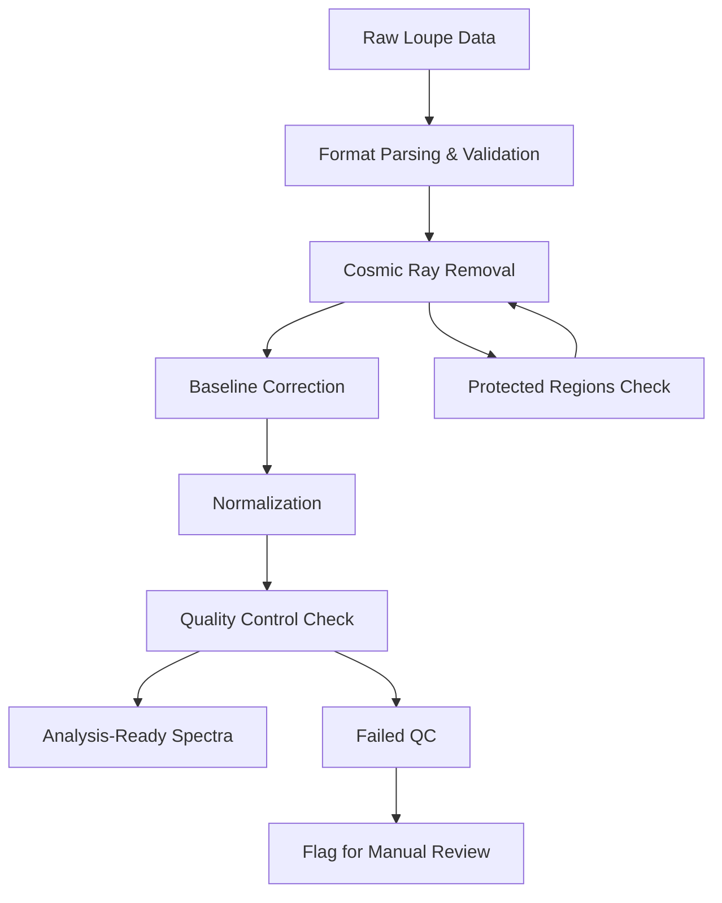

# Methods & Reproducibility

**SHERLOC Pipeline Analysis Framework**
**Version:** 5.0.0
**Date:** 2026-01-25
**Pipeline SHA:** `git log -1 --format="%H"`

> **Freshness note.** Dataset counts and experimental result tables in this document describe an earlier codebase and database state (cut-off 2026-01). Algorithm parameters and citation entries were re-audited against `src/sherloc_pipeline/config.yaml` and Crossref. For current database statistics, run `sherloc db-stats`.

---

## Table of Contents

1. [Data Provenance](#1-data-provenance)
2. [Preprocessing Pipeline](#2-preprocessing-pipeline)
3. [Peak Fitting Methods](#3-peak-fitting-methods)
5. [Vision Processing Methods](#5-vision-processing-methods)
7. [Software Environment](#7-software-environment)
10. [Reproducibility Guidelines](#10-reproducibility-guidelines)
11. [References](#11-references)

---

## 1. Data Provenance

### 1.1 Dataset Overview

The SHERLOC (Scanning Habitable Environments with Raman & Luminescence for Organics & Chemicals) instrument aboard the Mars 2020 Perseverance rover has collected spectroscopic data from Martian surface materials in Jezero Crater since Sol 58.

**Dataset Statistics (snapshot, 2026-01):**

The values below describe the dataset as it existed at the 2026-01 cut-off and are the basis for the experimental results discussed later in this document. Run `sherloc db-stats` (or `sqlite3 ./phase.db ".tables"`) for current counts on the live database.

- **Total R1 Spectra:** 524,181
- **Total Scans:** 981
- **Total Sols:** 152
- **Mars Target Scans:** 648 (66.1%)
- **Calibration Scans:** 333 (33.9%)
- **Detail Scans (100 points):** 344
- **Database Size:** 2.22 GB
- **Collection Period:** Sol 58 - Sol 1266

### 1.2 SHERLOC Instrument Specifications

Bhartia et al. (2021) report a 248.6 nm laser with 40 μs pulses and a ~100 μm spot. The R1, R2 and R3 wavelength bounds are the values in `src/sherloc_pipeline/config.yaml`. See `docs/schema/SPECTRAL_REGIONS.md` for the authoritative wavelength↔wavenumber mapping.

| Parameter | Specification |
|-----------|---------------|
| **Laser** | Pulsed deep-UV neon-copper, 248.5794 nm (`wavelength.laser_wavelength` in `config.yaml`; 40 μs pulses) |
| **Spectral Regions** | R1 (Raman), R2/R3 (Fluorescence) |
| **R1 Range** | 250-282 nm |
| **R2 Range** | 282-337.8 nm |
| **R3 Range** | 337.8-357.4 nm |
| **Spot Size** | ~100 μm diameter |
| **Working Distance** | ~48 mm (Bhartia et al. 2021) |

### 1.3 Data Sources and Processing Levels

**Primary Data Source:** SHERLOC Loupe format files [@Bhartia2021]
- **Format:** Binary with embedded metadata
- **Processing Level:** EDR (Experimental Data Record) to RDR (Reduced Data Record)
- **Calibration:** Dark subtraction

**Loupe software:** Uckert, K. (2022). nasa/Loupe: LoupeV5.1.5 (version LoupeV5.1.5a). Zenodo. doi:10.5281/zenodo.7062998 [@Loupe2022].

**Scan Types** (the `ScanType` values in `models/spectra.py`, resolved from the scan name by `classify_scan_type`):
1. **Detail:** standard Mars surface scan
2. **Survey:** large grid / areal-coverage scan
3. **Line:** 1-D traverse scan (constituent of cross and asterisk composites)
4. **HDR:** high-dynamic-range scan
5. **Calibration:** calibration and engineering scans: AlGaN, laser-off darks, calibration-target materials, the meteorite, maze, laser power housekeeping, passive, and pulse-count intensity tests

**Acquisition Parameters:**
- **Pulses per Point (PPP):** 25-1000 (median: 100)
- **Integration Time:** Variable (5-60 seconds per point)
- **Atmospheric Pressure:** ~6-8 mbar (CO₂ dominated)

### 1.4 Target Context Integration

**Target Field Enhancement:**
- **Geological Context:** Added target field to 967/981 scans (98.6%)
- **Target Categories:** Rock outcrops, regolith, drill tailings, calibration materials
- **Spatial Context:** ACI imagery linked via SCLK timestamps (±5-60s tolerance)

---

## 2. Preprocessing Pipeline

The preprocessing pipeline transforms raw Loupe format data into analysis-ready spectral arrays through a series of validated processing steps.

### 2.1 Data Ingestion and Validation

**Format Parsing:**
```python
# Loupe format parsing with validation
def parse_loupe_scan(file_path: Path) -> List[Spectrum]:
    """Parse Loupe binary format to Pydantic Spectrum models."""
    # Binary structure parsing with CRC validation
    # Metadata extraction (sol, target, coordinates)
    # Spectral array reconstruction
```

**Quality Control Checks:**
- Header CRC validation
- Spectral array completeness
- Wavelength calibration verification
- Metadata consistency checks

### 2.2 Cosmic Ray and Spike Removal

**Algorithm:** Robust rolling-median residual with a MAD-derived threshold, adapted from Whitaker & Hayes (2018) [@Whitaker2018].

**Parameters (`DespikeParams`):**
```python
window_size: int = 7              # Rolling window size
zscore_threshold: float = 6.0     # Robust z-score cutoff
max_iterations: int = 1           # Despiking passes
interpolation_method: str = "linear"
run_length_max: int = 2           # Maximum consecutive spikes
```

**Protected Regions:**
- **Laser line:** 600-700 cm⁻¹ (excluded from despiking)
- **Sulfate guard:** 990-1050 cm⁻¹ (conditional protection for genuine peaks)

**Implementation:**
```python
def despike_r1_spectrum(intensity_series: pd.Series,
                       params: DespikeParams) -> pd.Series:
    """Remove cosmic ray spikes using robust statistics."""
    # Compute rolling median and MAD
    median = intensity_series.rolling(window=params.window_size,
                                    center=True).median()
    residual = intensity_series - median
    mad = np.median(np.abs(residual - np.median(residual)))

    # Flag outliers exceeding z-score threshold
    threshold = params.zscore_threshold * 1.4826 * mad
    spikes = np.abs(residual) > threshold

    # Apply run-length and exclusion constraints
    # Interpolate flagged spikes
```

### 2.2.1 Cosmic-Ray Detection and Removal — ML Detector (v1.3)

**Overview.** Starting with pipeline v4.2.0, the default despike method is `ml`
(`despike_method ∈ {ml, modz, none}`). The ML detector replaces the legacy modz
algorithm as the default because, on held-out test data, it has a roughly 5×
lower false-flag (false-positive) rate and better cosmic-ray recall at every
amplitude, while leaving genuine mineral and organic bands intact. Detection runs
at processing time, producing per-spectrum channel masks that are persisted in the
database; the web server applies the stored masks by simple interpolation and
never runs model inference.

**Install.** The ONNX runtime is an optional dependency in the `[ml-despike]`
extra:

```bash
pip install 'sherloc-pipeline[ml-despike]'
```

`none` and `modz` paths require no extra and never import `onnxruntime`.

#### Input contract

The detector's input is the **raw paired ACTIVE and DARK
planes**, 2148 channels × 3 regions (R1/R2/R3), in raw DN — as read from the
Loupe workspace files `activeSpectra.csv` and `darkSpectra.csv`. Per-frame
robust normalization happens inside featurization, not upstream. Inputs must be
1-D float arrays of length 2148.

#### Featurization

Reference implementation: `src/sherloc_pipeline/ml_despike/featurize.py`.

Per plane, over the detection window `[lo, hi)` for the frame's
region:

```
med   = median(plane[lo:hi])
mad   = median(|plane[lo:hi] − med|)
scale = 1.4826 · mad + 1.0
```

The 8 input channels (float32, shape `(8, 2148)`):

| Channel | Formula |
|---------|---------|
| `x0` | `(active − med_a) / scale_a` |
| `x1` | `(dark − med_d) / scale_d` |
| `x2..x4` | Region one-hot broadcast (R1/R2/R3) |
| `x5` | `log10(scale_a) / 4.0` |
| `x6` | `log10(scale_d) / 4.0` |
| `x7` | `log10(1 + |median(active[lo:hi])|) / 4.0` |

`featurize_batch` stacks per-frame features to shape `(N, 8, 2148)`.

#### Frozen operating point

The operating point is frozen in-code in
`src/sherloc_pipeline/ml_despike/manifest.py` and is not user-tunable. The
thresholds are rate-matched per region and fixed for the released v1.3 model
(provenance label `ml_v1.3_tau_matched`).

**Per-region decision thresholds (taus):**

| Region | tau (full precision) |
|--------|----------------------|
| R1 | `0.29882812500038747` |
| R2 | `0.2656250000008831` |
| R3 | `0.2656250000008831` |

R2 and R3 share the fluorescence tau.

**Detection windows `[lo, hi)`:**

| Region | Window |
|--------|--------|
| R1 | `(52, 575)` |
| R2 | `(575, 1677)` |
| R3 | `(1677, 2140)` |

A channel is flagged when `p > tau[region]` (strict) inside the window, where
`p = sigmoid(logits)` is computed in float64
(`1 / (1 + exp(−logits.astype(float64)))`). Flags are returned as absolute
channel indices (0–2147).

#### Artifact identity

The fp32 ONNX deployment artifact is the sole artifact executed by the
pipeline:

| Item | Value |
|------|-------|
| Filename | `v1_stageB_v13c.onnx` |
| ONNX sha256 | `9668a0b2ca257ce333d57e3f76598dda8cb5c1839e2fde6bd955086d959be0ba` |
| Source checkpoint sha256 | `a77cd435d65631a8728c9d39c01c31dd30805ac37062b8c48937be6fb3594881` |
| Fetch URL | `https://github.com/archaeon-ai/sherloc-pipeline/releases/download/model-cr-despike-1.3/v1_stageB_v13c.onnx` |
| Cache path | `~/.cache/sherloc-pipeline/ml_despike/v1_stageB_v13c.onnx` |

The source checkpoint sha256 is recorded for provenance only; the checkpoint is
never fetched or loaded by the pipeline. The fetch is sha256-pinned: the digest
is verified before the file reaches its loadable cache name; mismatches are
quarantined (renamed to `<name>.corrupt-<ts>`), never loaded.

#### Provenance semantics

Every run records the following provenance, in pipeline metadata,
`ServiceResult.metadata["despike"]`, and the `cr_masks.json` run artifact:

```json
{
  "method": "ml_v1.3_tau_matched",
  "model_sha256": "9668a0b2ca257ce333d57e3f76598dda8cb5c1839e2fde6bd955086d959be0ba",
  "tau": {
    "R1": 0.29882812500038747,
    "R2": 0.2656250000008831,
    "R3": 0.2656250000008831
  },
  "ort_version": "<installed onnxruntime version>"
}
```

The installed `onnxruntime` version is recorded (not the reference version) so
any flag discrepancy under a later runtime is attributable. Masks persisted to
the `cosmic_ray_masks` database table carry the same provenance trio
(`method`, `model_sha256`, `tau`).

#### Reference configuration vs installed configuration

The reference runtime configuration is **onnxruntime 1.26.0,
CPUExecutionProvider, fp32, opset 18**. Later 1.x onnxruntime versions are
operationally acceptable but not the reference configuration; the installed version is recorded in
run provenance as noted above. Changing the reference-configuration line in this
document requires a recorded local parity re-run (zero symmetric difference on
the golden batch via `scripts/verify_ml_despike_parity.py`) — this is an
integration parity check, not a model re-evaluation.

#### Coverage limits

The ML detector flags channels only within its detection windows
(§ Frozen operating point above). In combined representations the uncovered
contributions — channels where a contributing region's detection window does not
include the channel — retain exactly the legacy never-screened behavior. (The
legacy modz method never despiked the fluorescence or R123 representations at
all, so every covered channel is a strict improvement.)

Coverage for the Loupe R123 summation view (derived from
`core/r123_stitching.py` segment map and `DEFAULT_MANIFEST.region_windows`):

| Channels | Contributors | Covered | Uncovered |
|----------|-------------|---------|-----------|
| `[0, 52)` | {R1} | — | R1 (below window) |
| `[52, 565)` | {R1} | R1 | — |
| `[565, 575)` | {R1, R2} | R1 | R2 (below window) |
| `[575, 690)` | {R1, R2} | R2 | R1 (above window) |
| `[690, 1668)` | {R2} | R2 | — |
| `[1668, 1677)` | {R2, R3} | R2 | R3 (below window) |
| `[1677, 1690)` | {R2, R3} | R3 | R2 (above window) |
| `[1690, 2140)` | {R3} | R3 | — |
| `[2140, 2148)` | {R3} | — | R3 (above window) |

Derived uncovered-contributor counts: **207 of 2148** channels carry at least
one uncovered contributor in the R123 summation view (147 overlap channels + 60
edge channels). The fluorescence full-plane sum (R2 + R3 across all 2148
channels) carries an uncovered contributor at **every** channel (2148).

The fluorescence fitters (`services/fitting.py` `fit_fluorescence` and
`services/map_fitting.py` map mode) receive ML-despiked R1–R3 input through
stored masks; see §2.2.3. Other R123 consumers do not.

#### Characterized behavior summary

Two science-favorable performance trades are characterized on held-out test data:

- **High pulses-per-point, fluorescence:** at high PPP the ML detector trades
  some fluorescence weak-mid recall for a 2–5× lower false-alarm rate relative
  to the legacy method.
- **R1 weak-dip sparing:** the detector exhibits conservative sparing of weak
  dip features in R1.

Genuine mineral and organic bands were left intact on the held-out test data, and
the false-flag (false-positive) rate is roughly 5× lower than the legacy method.

#### Adaptation guidance for power users

To run the detector standalone on custom active/dark plane pairs:

```python
from sherloc_pipeline.ml_despike import (
    MLCRDetector,
    DEFAULT_MANIFEST,
    resolve_artifact,
    featurize_batch,
)

# Resolves and digest-verifies the cached artifact (fetches if absent).
detector = MLCRDetector()

# actives, darks: lists of 1-D numpy arrays, length 2148, raw DN.
# regions: list of "R1", "R2", or "R3" labels, one per frame.
masks = detector.detect(actives, darks, regions)
# masks: list of int64 arrays — absolute channel indices (0–2147) per frame.
```

The `detect` method signature is:

```python
def detect(
    self,
    actives: Sequence[np.ndarray],   # raw ACTIVE planes, 1-D length-2148
    darks: Sequence[np.ndarray],     # raw DARK planes, parallel to actives
    regions: Sequence[str],          # "R1" / "R2" / "R3", one per frame
) -> List[np.ndarray]:              # sorted absolute channel indices per frame
```

`MLCRDetector.__init__` accepts optional arguments:

```python
MLCRDetector(
    manifest=DEFAULT_MANIFEST,   # frozen identity; use DEFAULT_MANIFEST
    artifact_path=None,          # explicit artifact path (digest-verified); default fetches/caches
    intra_op_threads=2,          # ORT intra-op thread count; reference config is 2
)
```

The `featurize_batch` function is available for inspection or testing without
invoking inference:

```python
features = featurize_batch(actives, darks, regions)
# features: (N, 8, 2148) float32
```

Returned masks are absolute channel indices (0–2147) on each region's
2148-channel plane. The `none` and `modz` methods require no extra and produce
no masks from this package.

### 2.2.2 Anomalous pixel overlay

The optional Workbench overlay marks anomalous pixels (Jakubek et al. 2025, Supplemental Tables S3 and S4).
In stowed-arm scans, these pixels fell beyond ±3σ more often than expected from noise.
Table S3 covers the R1 Raman region and Table S4 covers the R2 and R3 fluorescence regions.
The overlay reads absolute CCD indices from `data/anomalous_pixels.csv` through
`GET /api/spectra/anomalous-pixels` and changes no spectral value.

---

### 2.2.3 Fluorescence Fit Input: ML-Despiked R1–R3 with Laser Normalization

Fluorescence is fitted on the dark-subtracted R1, R2 and R3 spectra with the
stored ML cosmic-ray masks applied, and is then laser-normalized. Organics,
hydration and fluorescence fit despiked input, because their broad features are
hard to confuse with cosmic rays; minerals fit non-despiked input.

**Despiked rows.** For each scan point and region, the dark-subtracted spectrum
takes its newest stored mask (§2.2.1). The flagged channels inside the region's
certified detection window are replaced by interpolation
(`preprocessing.despike.interpolation_method`, default linear). This is the same
replacement the web stored-mask toggle uses. The result is stored as its own
`spectra` row with `spectrum_type = "dark_sub_despiked"` and processing level
`despiked`. No baseline is subtracted. Peaks and masks never attach to these
rows: fluorescence peaks stay linked to the point's measured R2 spectrum.

**When the rows are built.**
- In `run_full_pipeline`, mask persistence runs before fluorescence fitting.
  Every run with a database then clears the scan's despiked rows, and rebuilds
  them only from masks persisted by that run. A run despiked another way (or
  not at all), or one whose mask stage failed, therefore leaves no despiked
  rows.
- For scans processed by versions without despiked rows,
  `sherloc backfill-fluor-inputs` builds the rows from the masks already stored.

**Which input a fit uses.** A point is fitted on its despiked rows only when all
three regions have one that is newer than both its dark-subtracted parent and
the parent's newest stored mask. Otherwise it is fitted on the measured
dark-subtracted (else active) spectra, and the fit says so:
- the result metadata (`input`) records `points_despiked` and `points_fallback`;
- a warning is raised when any point falls back;
- map mode adds a per-point note.

**Laser normalization.** After the input is chosen, each point's R1–R3 spectra
are scaled by `max_pd / pd_i`, the Loupe convention (`core/laser_normalization.py`).
Here `pd_i` is the point's mean photodiode reading and `max_pd` the largest in
the scan. A per-point scale commutes with the masked interpolation, so masking
then scaling equals masking the normalized spectrum. Points without a photodiode
reading are not scaled and are counted. The stage is a single function
(`apply_fluorescence_laser_normalization`) behind
`fluorescence_fitting.laser_normalize`. The flag is explicitly `false` in
`config.yaml`: normalization is switched on with the fluorescence re-fit sweep,
so all stored fits change units together. Until then fits use the
un-normalized input.

**In-fitter clip.** `fit_fluorescence_spectrum` still applies its rolling-median
clip (`clip_cosmic_spikes`), now as a backstop for spikes the stored masks did
not cover. It preserves 7–8 nm bands and the 304/325 nm doublet
(`tests/unit/core/test_fluor_clip.py`). On strong bands its noise estimate runs
low, so it can replace a few flat-region channels at noise level.

Fluorescence group numbers follow Sharma et al. (2023) [@Sharma2023], who report the group 1 doublet at roughly 303 and 325 nm. This pipeline labels its two components 1a and 1b.

**Counts and exposure.**
- Spectra counts (ingestion statistics, PDS validation) count
  measured types only.
- The derived type is not offered as a data source in the web UI or API.
- Downstream, the PHASE ingest reads `spectrum_type = 'dark_subtracted'` only,
  so the derived rows do not reach PHASE products.

### 2.3 Baseline Correction

**Primary Method:** Adaptive smoothness penalized least squares (aspls) [@Zhang2020], as implemented by `pybaselines.Baseline.aspls` [@PyBaselines2022].

**Parameters (`BaselineParams`, defaults from `src/sherloc_pipeline/config.yaml`):**
```python
lam: float = 1.0e6         # Smoothness parameter (higher = smoother)
asymmetric_coef: float = 0.01  # Asymmetry coefficient
iters: int = 10            # Maximum iterations
diff_order: int = 2        # Difference operator order
tol: float = 0.001         # Convergence tolerance
```

The aspls algorithm adapts the smoothness penalty along the spectrum, allowing flatter regions to receive stronger smoothing than peak-rich regions. R1 fits also apply soft "keep windows" (configurable in `config.yaml`) that down-weight the baseline within ranges where genuine peaks are expected, reducing under-fit at strong features.

The web baseline workspace fits and subtracts over the full R1 spectrum by
default. Operators may instead zoom the spectrum and select **Current zoom**;
in that mode asPLS is fit and subtracted only within the visible wavenumber
interval, while channels outside the interval remain unchanged. This local
correction avoids allowing unrelated portions of the spectrum to bend the
baseline in the region of interest.

### 2.4 Normalization Strategies

**Vector Normalization (Default):**
```python
def l2_normalize(spectrum: np.ndarray) -> np.ndarray:
    """L2 normalization to unit vector length."""
    return spectrum / np.linalg.norm(spectrum)
```

**Alternative Normalization Methods:**
- **Min-Max:** Scale to [0, 1] range
- **Standard:** Zero mean, unit variance
- **Robust:** Median centering, MAD scaling
- **Peak:** Normalize to highest peak intensity

---

## 3. Peak Fitting Methods

### 3.1 Multi-Gaussian Fitting

**Model:** Sum of independent Gaussian peaks
```python
def gaussian(x: np.ndarray, center: float, amplitude: float,
             fwhm: float) -> np.ndarray:
    """Single Gaussian peak model."""
    sigma = fwhm / (2 * np.sqrt(2 * np.log(2)))
    return amplitude * np.exp(-0.5 * ((x - center) / sigma) ** 2)

def multi_gaussian(x: np.ndarray, params: np.ndarray) -> np.ndarray:
    """Sum of Gaussians: params = [m1,a1,f1, m2,a2,f2, ...]"""
    y = np.zeros_like(x)
    for i in range(0, params.size, 3):
        center, amplitude, fwhm = params[i:i+3]
        y += gaussian(x, center, amplitude, fwhm)
    return y
```

### 3.2 Peak Detection and Initial Estimates

**Peak Detection:** SciPy `find_peaks` with adaptive thresholds
```python
def detect_peaks(spectrum: np.ndarray, wavenumber: np.ndarray,
                prominence_factor: float = 0.1) -> List[int]:
    """Detect peak candidates using adaptive prominence."""
    baseline_noise = np.std(spectrum[:50])  # Estimate from edges
    min_prominence = max(prominence_factor * np.max(spectrum),
                        3 * baseline_noise)

    peaks, properties = find_peaks(spectrum,
                                  prominence=min_prominence,
                                  width=2,  # Minimum width in channels
                                  distance=5)  # Minimum separation
    return peaks
```

### 3.3 Nonlinear Optimization

**Method:** Trust Region Reflective (scipy.optimize.least_squares)
```python
def fit_peaks(wavenumber: np.ndarray, intensity: np.ndarray,
              initial_params: np.ndarray) -> FitResult:
    """Fit multiple Gaussian peaks to spectrum."""

    def residuals(params):
        model = multi_gaussian(wavenumber, params)
        return intensity - model

    # Parameter bounds: [center_min, amplitude_min, fwhm_min, ...]
    bounds = build_parameter_bounds(initial_params, wavenumber)

    result = least_squares(residuals, initial_params,
                          bounds=bounds, method='trf',
                          ftol=1e-12, xtol=1e-12, gtol=1e-12)

    return build_fit_result(result, wavenumber, intensity)
```

### 3.4 Model Selection and Quality Metrics

Two model-selection strategies are supported for choosing the number of Gaussian components: AICc (the default in the bundled `config.yaml`) and a sequential F-test. Both operate on the same candidate seeds and the same nonlinear least-squares fit; they differ only in the rule used to stop adding peaks. The active strategy is set by `fitting.model_selection` in `config.yaml` (`"aicc"` or `"ftest"`).

**Sequential F-test:**

Adds peaks one at a time starting from the null model (y=0). After each addition, computes the F-statistic for the nested-model comparison:

```
F = ((RSS_n − RSS_{n+1}) / Δk) / (RSS_{n+1} / dof_{n+1})
```

with Δk=3 (each Gaussian adds m, a, fwhm) and dof = N − 3·peaks. The F-distribution gives a p-value; if `p < ftest_alpha` (default 0.01) the new peak is retained and the search continues. **The first non-significant addition halts the search** (greedy stop). Strict statistical control over the false-positive rate per addition; assumes Gaussian residuals.

```python
def f_test_pvalue(rss_reduced: float, rss_full: float,
                  dof_reduced: int, dof_full: int,
                  delta_params: int) -> float:
    """p-value for nested-model F-test (Δk=3 per Gaussian)."""
    f_stat = ((rss_reduced - rss_full) / delta_params) / (rss_full / dof_full)
    return 1.0 - f_dist.cdf(f_stat, delta_params, dof_full)
```

**Corrected Akaike Information Criterion (AICc, default):**

Fits every candidate peak count from `aicc_min` (default 1) to `aicc_max` (default 5) in increasing order. A larger model replaces the current best only when it lowers AICc by more than `parsimony.aicc_improve_threshold` (default 0, which keeps the strict minimum). Balances goodness-of-fit against parameter count via the +2k penalty term plus a small-sample correction.

With `parsimony.reject_merged_candidates: true` (default), a candidate is skipped when two of its reportable components lie closer than half `peak_separation_cm1`: the post-fit merge step would drop one of them, so that candidate's AICc was earned by a component the output does not keep.

**Negative-spike exclusion (minerals):** ROI channels below `-minerals_negative_spike_sigma × noise_std` (default 10) get zero weight. They are left out of peak seeding, the least-squares residual, RSS, AICc (n counts only the retained channels, in model selection and in the exported summary) and R²; the returned model still covers every ROI channel. The fit reports `negative_spike_channels_masked:N`. If every ROI channel is excluded, the point is a no-peaks result. Organics and hydration fits are unchanged.

**Cosmic-ray review flag:** when a spectrum's cosmic-ray mask positions are supplied, each fitted peak carries `cr_mask_review` (a mask channel lies within center ± FWHM/2). It is a review flag only: it never removes a peak and never changes the fit input.

**Mineral fit input:** laser-normalized, dark-subtracted spectrum, asPLS-baselined (`normalized_baselined`); spikes are handled by negative-spike exclusion and the cosmic-ray review flag (not standard "despiked" as used for organics, hydration and fluorescence fitting).

```python
def compute_aicc(n_samples: int, rss: float, num_params: int) -> float:
    """Compute AICc for model selection."""
    aic = n_samples * np.log(rss / n_samples) + 2 * num_params
    correction = 2 * num_params * (num_params + 1) / (n_samples - num_params - 1)
    return aic + correction
```

For fluorescence fitting (`domain="fluorescence"`), AICc is used for model selection regardless of the UI selection.

**Selection marks and the size log:** the AICc search fits the candidate sizes anyway, so it records every size from 1 (including any below `aicc_min_peaks`, which AICc may not pick), and each persisted component carries three marks of how model selection treated it. The marks are records only: they never add, remove or change a kept component. A component's seed height rank is k (1 = tallest seed); its marks describe the step from k−1 to k peaks:

- `aicc_gain` = AICc(k−1) − AICc(k). Positive means adding this component lowered AICc.
- `step_p` = the F-test p-value of the same step (the statistic above, Δk = 3).
- `kept_by` = `both` when the F-test pick, derived from the same fits, also persists a component within 2 cm⁻¹ of this one through the same persist gates (SNR, FWHM, sharpness, the domain gates, and the R² floor applied to the F-test pick's own R²); `aicc` when it does not. `ftest` is reserved for a component only the F-test pick keeps; those are not persisted.

The F-test pick needs no extra fit (with `aicc_min_peaks` above 1, the sizes below it are fitted for the log only): both rules refit a given size from the same start with the same bounds, so the sequential F-test's stopping point can be read from the AICc search's sizes (size 0 is the null model y = 0). All three marks are NULL when not computed: rows fitted by earlier versions, fits with no size search (the hydration F-test rule, the organics D+G fit with fixed seeds, `model_selection: "ftest"`), and a step whose size failed to fit. `aicc_gain` and `step_p` also appear as columns of each point's peak table.

For the mineral fit and the organics G fit, the size log is written per point, as compact JSON, beside the peak table: `..._point<N>_fit_peaks.csv` → `..._point<N>_fit_sizes.json` (organics G fit: `..._organics_g_sizes.json`). It is never loaded into a database; a non-finite number (for example AICc at an RSS of exactly 0) is written as null. Format `fit-sizes/1`:

| Field | Meaning |
|---|---|
| `version` | `"fit-sizes/1"` |
| `n` | channels the fit used |
| `rss0`, `aicc0` | RSS and AICc of the null model y = 0 |
| `ftest_alpha` | the F-test significance level |
| `sizes[]` | one entry per size `p`: `seed_ranks` (seed height rank of each parameter slot), `params` (center, amplitude, FWHM per peak), `rss`, `aicc`, `aicc_eligible` (false below `aicc_min_peaks`: logged for the F-test pick and the steps, never picked by AICc), `merge_skip` (skipped by `reject_merged_candidates`), `failed` (the fit raised; `params`, `rss`, `aicc` are null), `step_aicc_gain`, `step_p` |
| `aicc_size` | the size AICc kept (null: no size was admissible) |
| `ftest_size` | the size the sequential F-test keeps (0: no step passes) |
| `ftest_r2`, `ftest_peaks` | the F-test pick's R² and its output components after the same prune and merge steps (center, FWHM, amplitude, area, SNR, pass flags, sharpness ratio, `seed_rank`, `aicc_gain`, `step_p`) |

**Quality Thresholds (defaults from `src/sherloc_pipeline/config.yaml`, minerals domain):**
- **R²:** per-peak `pass_r2` flag at ≥ 0 (`r_squared_min`); persistence still requires R² > 0 (`posthoc_filters.r2_min`)
- **SNR:** ≥ 3.0 (`min_snr`)
- **FWHM:** initial-search lower bound 22 cm⁻¹ (`fit_fwhm_min_initial_cm1`), upper bound 90 cm⁻¹ (`fwhm_max_cm1`); post-fit `pass_fwhm` flag ≥ 25 cm⁻¹ (`filter_fwhm_min_cm1`); reviewable/persist eligibility ≥ 25 cm⁻¹ (`reviewable_fwhm_min_cm1`)

Organics use their own R² minimum, `organics_r2_min` (0.25), for the G gate and the D+G fit; the mineral `r_squared_min` does not apply to them. Domain overrides (organics, hydration, fluorescence) are defined in the same `fitting:` block of `config.yaml` and may relax or tighten these defaults. The fluorescence `posthoc_filters` block sets `r2_min: 0.0` and `fwhm_min_cm1: 0.0`, disabling those post-hoc R² and FWHM rejection gates for the fluorescence domain.

The Workbench badge and the `quality` column in `peaks.csv` use the same rules for point and average spectra, including calibration and engineering scans. A negative R² or a sharpness ratio at or above the configured maximum gives `fail`. Otherwise, a peak earns `pass` at R² ≥ 0.8. A Raman peak must also have a measured FWHM within the requested fit bounds, including the endpoints. All other peaks receive `review`. The fluorescence fitter applies its own width filter.

The map classification editor starts with the fitter's peak-center windows, in cm⁻¹ for Raman bands and nm for fluorescence groups. It displays each window as its midpoint and half-width. At a shared endpoint, the editor follows the fitter (the higher window for minerals, the first listed group for fluorescence), and the layer labels show the applied window centers.

**References:**
- F-test for nested models: standard derivation; implementation in `core/fitting.py:_f_test_pvalue`.
- AICc: Burnham & Anderson (2002), *Model Selection and Multimodel Inference*; implementation in `core/fitting.py:_compute_aicc`.

---

## 5. Vision Processing Methods

### 5.1 ACI Image Processing

#### 5.1.1 Image Format Support

**VICAR Format Parser:**
```python
def read_vicar_image(file_path: Path) -> tuple[np.ndarray, dict]:
    """Read VICAR format ACI images with metadata extraction."""
    with open(file_path, 'rb') as f:
        # Parse VICAR label
        label = parse_vicar_label(f)

        # Extract image dimensions and data type
        width = label['NS']  # Number of samples
        height = label['NL']  # Number of lines
        data_type = label['FORMAT']

        # Read binary image data
        f.seek(label['LBLSIZE'])
        image_data = np.frombuffer(f.read(), dtype=data_type)
        image = image_data.reshape(height, width)

    return image, label
```

**ACI Specifications:**
- **Sensor:** 1648 × 1200 pixels
- **Resolution:** 10.1 μm/pixel
- **Field of View:** 16.6 × 12.1 mm
- **Format:** 8-bit grayscale, uncompressed
- **Metadata:** VICAR/PDS3 labels with acquisition parameters

## 7. Software Environment

### 7.1 Core Dependencies

**Python Environment:**
```yaml
Python: ">=3.9"
Primary Dependencies:
  numpy: ">=1.20.0"      # Numerical computing
  pandas: ">=1.3.0"      # Data manipulation
  matplotlib: ">=3.5.0"  # Plotting and visualization
  scipy: ">=1.8.0"       # Scientific computing
  scikit-learn: ">=1.0.0" # Machine learning
  scikit-image: ">=0.19.0" # Image processing

Spectroscopy-Specific:
  pybaselines: ">=1.0.0" # Baseline correction

Database:
  sqlalchemy: ">=2.0.0" # ORM and database abstraction
  alembic: ">=1.13.0"   # Database migrations

API Framework:
  pydantic: ">=1.10.0"  # Data validation
  typer: ">=0.9.0"      # CLI framework
  rich: ">=12.0.0"      # Terminal formatting
```

### 7.2 Version Control and Reproducibility

**Git SHA Tracking:**
```python
def get_code_sha() -> str:
    """Get current git commit SHA for reproducibility."""
    import subprocess
    try:
        result = subprocess.run(['git', 'rev-parse', 'HEAD'],
                              capture_output=True, text=True)
        return result.stdout.strip() if result.returncode == 0 else "unknown"
    except Exception:
        return "unknown"

# Embed in output metadata
metadata = {
    "schema_version": "1.0.0",
    "created_at": datetime.utcnow().isoformat(),
    "code_sha": get_code_sha(),
    "random_seed": 42,
    "python_version": sys.version,
    "numpy_version": np.__version__,
    "sklearn_version": sklearn.__version__
}
```

### 7.3 Configuration Management

**Centralized Configuration:**
```yaml
# config.yaml structure (excerpt; see src/sherloc_pipeline/config.yaml for full schema)
preprocessing:
  baseline_method: "aspls"
  despike:
    window_size: 7
    zscore_threshold: 6.0
    max_iterations: 1
  baseline:
    lam: 1.0e6
    asymmetric_coef: 0.01
    iters: 10
    diff_order: 2
    tol: 0.001
```

---

## 10. Reproducibility Guidelines

### 10.2 Output Metadata Standards

**Mandatory Metadata for All Outputs:**
```python
@dataclass
class AnalysisMetadata:
    """Standardized metadata for all analysis outputs."""
    schema_version: str = "1.0.0"
    created_at: str = field(default_factory=lambda: datetime.utcnow().isoformat())
    code_sha: str = field(default_factory=get_code_sha)
    random_seed: int = 42
    python_version: str = field(default_factory=lambda: sys.version)

    # Library versions
    numpy_version: str = field(default_factory=lambda: np.__version__)
    pandas_version: str = field(default_factory=lambda: pd.__version__)
    sklearn_version: str = field(default_factory=lambda: sklearn.__version__)

    # Hardware context
    cpu_info: str = field(default_factory=get_cpu_info)
    gpu_info: str = field(default_factory=get_gpu_info)
    total_memory_gb: float = field(default_factory=get_memory_info)

    def to_dict(self) -> dict:
        """Convert to dictionary for JSON serialization."""
        return asdict(self)
```

### 10.3 Data Versioning

**Dataset Versioning Strategy:**
```python
def compute_dataset_hash(spectra_paths: List[Path]) -> str:
    """Compute reproducible hash for dataset version tracking."""
    import hashlib

    hasher = hashlib.sha256()

    # Sort paths for deterministic ordering
    sorted_paths = sorted(spectra_paths)

    for path in sorted_paths:
        # Hash file path and modification time
        hasher.update(str(path).encode())
        hasher.update(str(path.stat().st_mtime).encode())

    return hasher.hexdigest()[:16]  # First 16 characters
```

---

## 11. References

### 11.1 Primary Literature

```bibtex
@article{Bhartia2021,
  title={Perseverance's Scanning Habitable Environments with Raman and Luminescence for Organics and Chemicals (SHERLOC) Investigation},
  author={Bhartia, Rohit and Beegle, Luther W. and DeFlores, Lauren and Abbey, William and Razzell Hollis, Joseph and Uckert, Kyle and others},
  journal={Space Science Reviews},
  volume={217},
  pages={58},
  year={2021},
  publisher={Springer},
  doi={10.1007/s11214-021-00812-z}
}

@article{Zhang2020,
  title={Baseline correction for infrared spectra using adaptive smoothness parameter penalized least squares method},
  author={Zhang, Feng and Tang, Xiaojun and Tong, Angxin and Wang, Bin and Wang, Jingwei},
  journal={Spectroscopy Letters},
  volume={53},
  number={3},
  pages={222--233},
  year={2020},
  publisher={Taylor \& Francis},
  doi={10.1080/00387010.2020.1730908}
}

@article{Whitaker2018,
  title={A simple algorithm for despiking Raman spectra},
  author={Whitaker, Darren A and Hayes, Kevin},
  journal={Chemometrics and Intelligent Laboratory Systems},
  volume={179},
  pages={82--84},
  year={2018},
  publisher={Elsevier},
  doi={10.1016/j.chemolab.2018.06.009}
}

@article{Jakubek2025,
  title={Spectral Background Calibration of Scanning Habitable Environments with Raman and Luminescence for Organics and Chemicals (SHERLOC) Spectrometer Onboard the Perseverance Rover Enables Identification of a Ubiquitous Martian Spectral Component},
  author={Jakubek, R. S. and others},
  journal={Applied Spectroscopy},
  volume={79},
  number={6},
  pages={904--918},
  year={2025},
  doi={10.1177/00037028241280081}
}

@article{Sharma2023,
  title={Diverse organic-mineral associations in Jezero crater, Mars},
  author={Sharma, Sunanda and Roppel, Ryan D. and Murphy, Ashley E. and others},
  journal={Nature},
  volume={619},
  number={7971},
  pages={724--732},
  year={2023},
  doi={10.1038/s41586-023-06143-z}
}

@article{Scheller2024,
  title={Inorganic interpretation of luminescent materials encountered by the Perseverance rover on Mars},
  author={Scheller, Eva L. and Bosak, Tanja and McCubbin, Francis M. and others},
  journal={Science Advances},
  volume={10},
  number={39},
  pages={eadm8241},
  year={2024},
  doi={10.1126/sciadv.adm8241}
}

@article{Haney2026,
  title={Multidisciplinary Analyses of Terrestrial Samples Used to Interpret an Inorganic Origin (Anhydrite:Ce$^{3+}$) for the 304 and 325-nm Doublet Fluorescence Detected by the Mars 2020 SHERLOC Instrument at Jezero Crater},
  author={Haney, N. C. and Morris, R. V. and Jakubek, R. S. and others},
  journal={Journal of Geophysical Research: Planets},
  volume={131},
  number={3},
  pages={e2025JE009385},
  year={2026},
  doi={10.1029/2025JE009385}
}
```

### 11.2 Software and Data References

```bibtex
@software{Williford2024,
  author={Williford, Kenneth H.},
  title={SHERLOC Pipeline: Mars 2020 Raman/Fluorescence Data Processing},
  version={5.7.8},
  year={2026},
  url={https://github.com/archaeon-ai/sherloc-pipeline}
}

@software{Loupe2022,
  author={Uckert, Kyle},
  title={nasa/Loupe: LoupeV5.1.5},
  version={LoupeV5.1.5a},
  year={2022},
  publisher={Zenodo},
  doi={10.5281/zenodo.7062998},
  url={https://zenodo.org/records/7062998}
}

@software{PyBaselines2022,
  author={Erb, Donald},
  title={pybaselines: A Python library of algorithms for the baseline correction of experimental data},
  url={https://github.com/derb12/pybaselines},
  doi={10.5281/zenodo.5608581}
}
```

---

## Appendix A: Algorithm Flowcharts

### A.1 Preprocessing Pipeline



---

*Document Version: 1.0.0*
*Generated: 2026-01-25*
*Pipeline Version: 3.0.0*
*Git SHA: [Embedded at runtime]*
